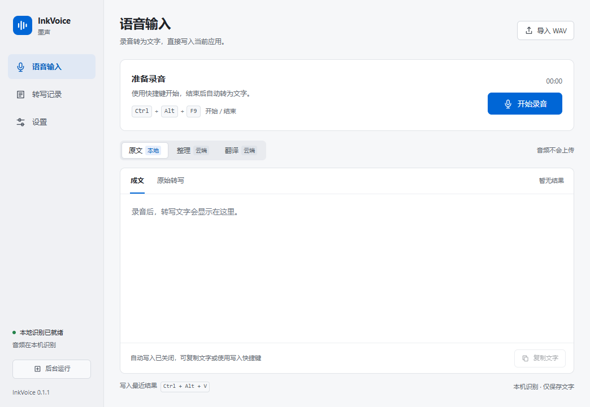

# 墨声 InkVoice

**在本机把语音转成文字，再写入当前应用。**

InkVoice is an open-source Windows x64 dictation prototype with local CPU speech recognition and optional bring-your-own-key Gemini text processing.



墨声使用 Electron、whisper.cpp 和多语言 Whisper 模型。默认在 CPU 上完成识别，不需要云端账户；可选的 Gemini 整理和翻译由你提供自己的 API 密钥（BYOK）。当前为 **0.1.1 未签名原型**，只支持 Windows x64。

## 已实现

- 麦克风录音、全局开始/结束快捷键，单次最长 5 分钟。
- 本地多语言 Whisper 识别；导入 16 kHz、16 位、单声道 PCM WAV。
- 保留只读原始转写，编辑成文、复制文字及个人词表替换。
- 根据前台窗口状态自动写入，或用 `Ctrl + Alt + V` 写入当前结果。
- 最近 30 条本机文字记录、托盘运行、麦克风和快捷键设置。
- 主动开启后使用 Gemini 整理或翻译转写文字。

## 开始使用

**推荐：下载便携版，无需配置开发环境。**

1. 打开 [v0.1.1 发布页](https://github.com/chendahe666/inkvoice/releases/tag/v0.1.1)，下载 **Windows x64 便携 ZIP**，而不是页面自动生成的 Source code。
2. 完整解压到可写目录，运行其中的 `InkVoice.exe`。
3. 在“设置”中选择麦克风并保存，即可录音。

便携版无需 Node.js。请保留整个文件夹，不能只复制单个 exe。发布页同时提供 `SHA256SUMS` 用于核对下载文件；当前版本为预发布原型。

**从源码运行：** 需要 Windows x64、Node.js **22.12.0 或更高版本**、npm、PowerShell 和 Windows .NET Framework x64 C# 编译器。在下载或克隆的项目目录中执行：

```powershell
git clone https://github.com/chendahe666/inkvoice.git
cd inkvoice
npm ci
node node_modules/electron/install.js
powershell -NoProfile -ExecutionPolicy Bypass -File .\scripts\setup-engine.ps1
powershell -NoProfile -ExecutionPolicy Bypass -File .\scripts\build-native.ps1
npm start
```

源码仓库不包含模型、运行时和编译产物。首次配置会下载 Electron、固定版本的 whisper.cpp CPU 运行时和约 60 MB 模型；语音引擎与模型下载会检查固定 SHA-256。安装、构建和排错见 [安装说明](docs/INSTALL.md)。

第一次使用时，在“设置”中选择麦克风并保存；将光标放在目标输入框，按工作台显示的快捷键开始，再按一次结束。识别后可以修改成文或复制。窗口关闭后会隐藏到托盘，需在托盘菜单选择“退出墨声”才能退出。完整流程见 [使用说明](docs/USAGE.md)。

## 隐私与云端处理

| 数据 | 处理与保存位置 |
|---|---|
| 录音 | 在本机识别；识别期间使用系统临时目录下的 `InkVoice-audio`，正常完成、失败或取消后清理。异常退出可能遗留临时文件。 |
| 转写与成文 | 默认以明文保存最近 30 条，位于 `data`；可以关闭或清空记录。 |
| Gemini 请求 | 仅主动选择“整理”或“翻译”时发送转写文字及词表；不发送音频或屏幕内容。 |
| API 密钥 | 由主进程使用；系统加密可用时才加密保存，不写入源码。也可使用 `GEMINI_API_KEY` 环境变量。 |

便携版的 `data` 位于 exe 旁，开发版位于项目根目录。**不要分享自己的 `data` 文件夹**：它可能包含私人文字、配置和加密凭据。仅配置密钥或环境变量不会自动开启云端处理。Gemini 的可用模型、额度和费用由你的账户决定。

本应用不采集屏幕或光标附近的文字。复制操作会把文字写入系统剪贴板；自动输入通过 Windows 输入接口完成。更多边界见 [安全说明](SECURITY.md)。

## 当前限制

- 停止录音后再识别，尚不支持实时逐字输出；长录音在 CPU 上需要等待。
- 默认模型较小，准确率受语言、口音、噪声和硬件影响；未建立日常听写准确率基准。
- 自动写入取决于窗口焦点、权限和编辑器兼容性，管理员窗口或特殊应用可能不接受输入。
- 云端整理可能改变措辞；失败时保留本地转写，并暂停该次自动写入。
- 尚无 macOS / Linux / iOS 版本、账户同步、开机启动、签名安装器或自动更新。

这是独立实现的原型，不宣称与任何商业语音输入产品在质量或兼容性上等效。

## 开发与贡献

```powershell
npm run check
npm run check:source
npm run check:controller
npm run check:windows
npm run smoke
npm run package
```

`npm run check` 离线串联源码、模拟控制器和模拟窗口检查；也可以分别运行三项。它不需要个人密钥、语音模型或既有测试证据。桌面 smoke 和打包需要先完成本地环境配置。详见 [贡献指南](CONTRIBUTING.md)。

源码采用 [MIT 许可证](LICENSE)。Electron、whisper.cpp 和模型的许可证见 [第三方声明](THIRD_PARTY_NOTICES.md)。
